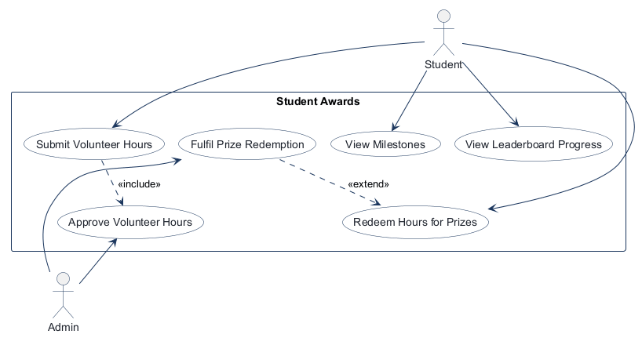
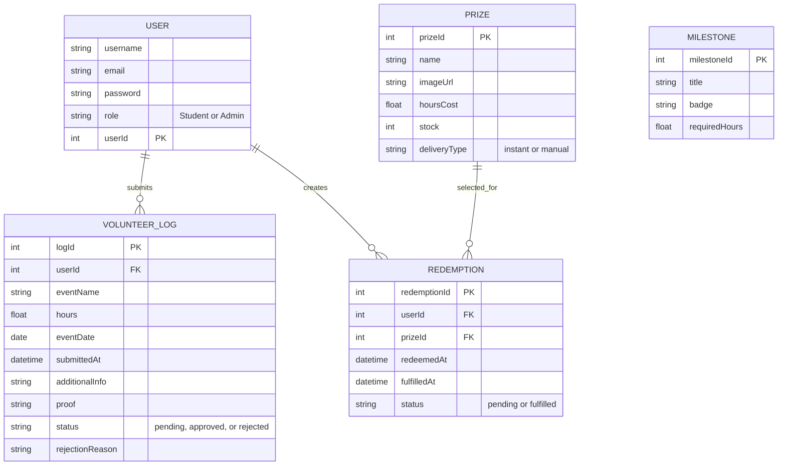
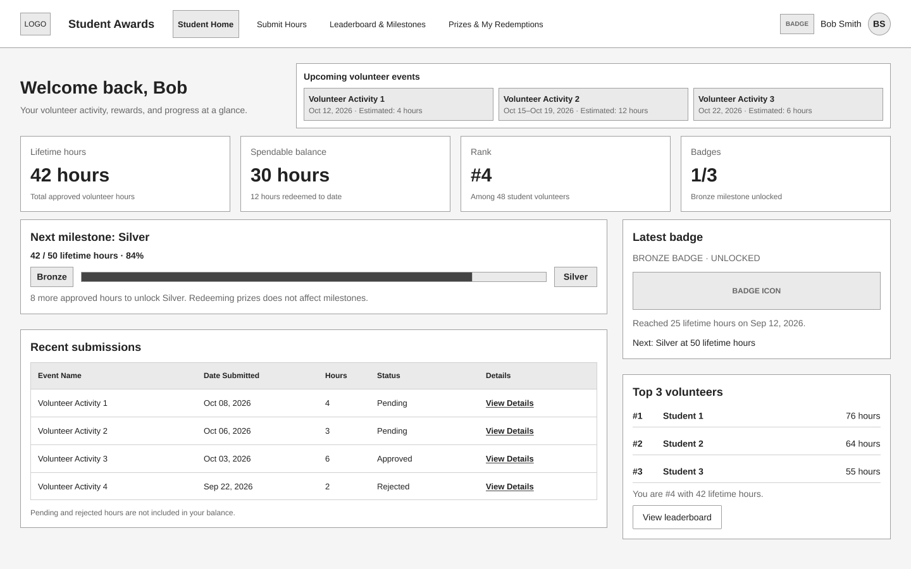
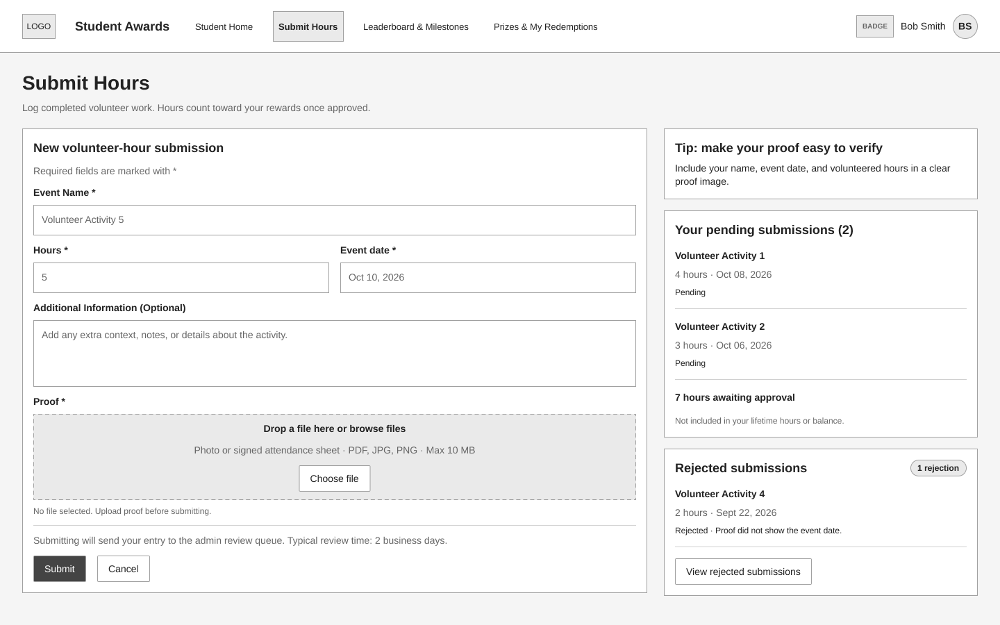
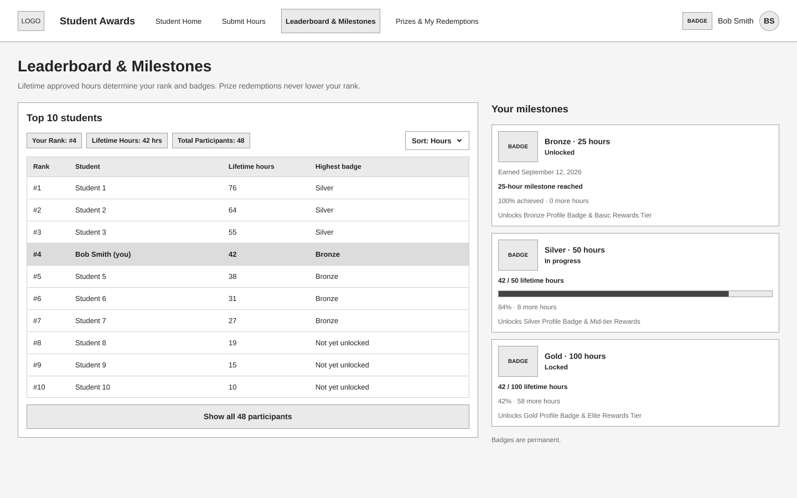
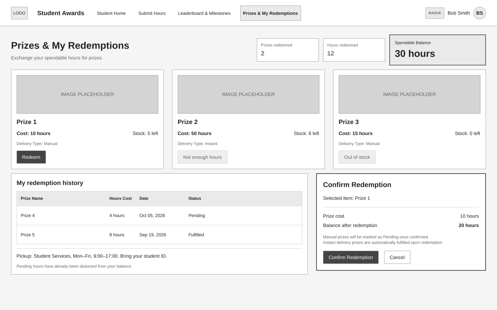
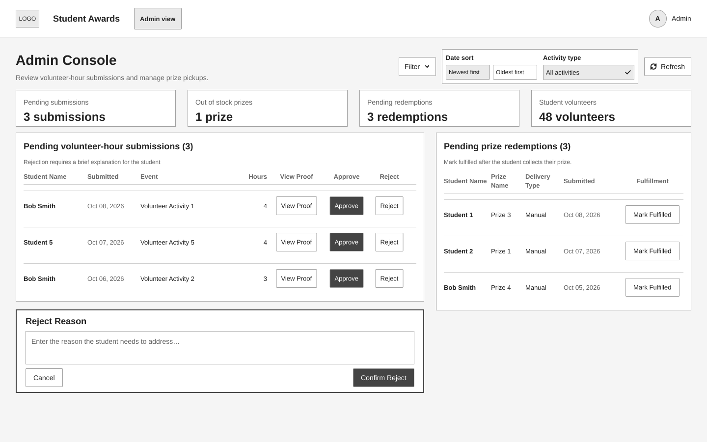
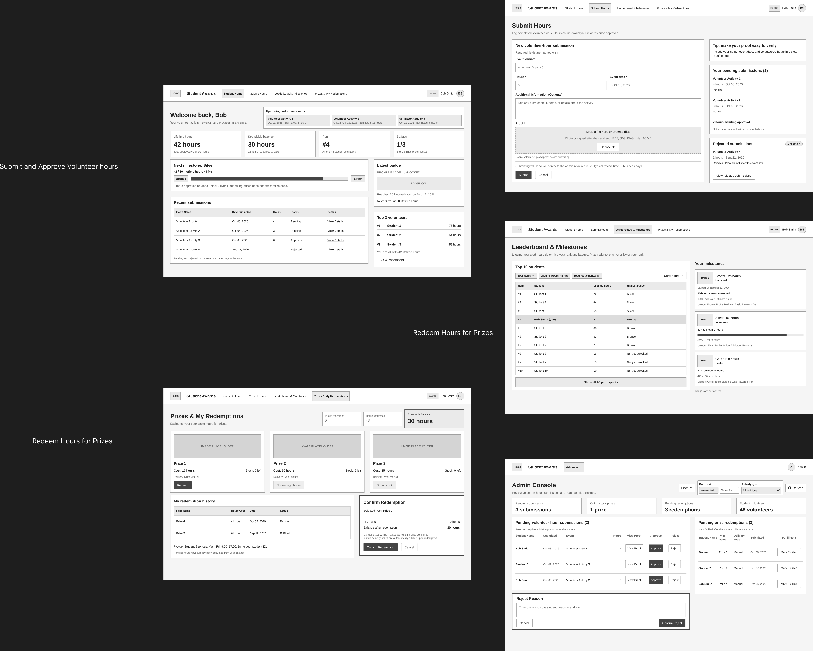

# COMP 3613 Assignment 1

Draft this file with the Guide. **Update it after every phase milestone** before you pause. The use-case diagram is a UML PNG at `docs/diagrams/use-case.png`, linked from this file as `diagrams/use-case.png` (path relative to `docs/report.md`). The model diagram is Mermaid. **Embed wireframe images** as `wireframes/<file>` (files live in `docs/wireframes/`).

Do not put your student ID in this file if you will commit it. The PDF cover adds your name and ID at export time.

## Assigned project

Student Awards (incentive system)

## Three workflows

### 1. Submit and Approve Volunteer Hours (Student, Admin)

### 2. Track Milestones and Leaderboard Progress (Student)

### 3. Redeem Hours for Prizes (Student; Admin fulfilment for selected prizes)

## Use case diagram

Phase 2 decisions: “Submit Volunteer Hours” includes the always-required “Approve
Volunteer Hours” step. “Track Milestones and Leaderboard Progress” is represented as
separate Student use cases. The prize list is part of “Redeem Hours for Prizes”.
Conditional Admin fulfilment is modelled as “Fulfil Prize Redemption” extending
“Redeem Hours for Prizes”; the base redemption use case is associated with Student.

## Model diagram

Phase 3 first draft. One User submits many VolunteerLogs, and one User creates many
Redemptions. One Prize can be selected by many Redemptions. Milestones are independent
threshold definitions; each user's progress is calculated from their approved
VolunteerLogs rather than stored as a direct Milestone relationship.

Business rules: only approved VolunteerLogs count toward milestone progress and prize
eligibility. A rejected VolunteerLog requires a rejectionReason. A Redemption requires
sufficient approved hours and available Prize stock. Update this model in Phase 5 if
polish reveals a need for stored progress, additional redemption details, or other
fields.

## Wireframes

The separate student-crafted wireframes cover all six use cases in the diagram.
The composite board is included as an overview.

### Student Home

### Submit Volunteer Hours

### Leaderboard and Milestones

### Prizes and Redemptions

### Admin Console

### Complete wireframe board

<!-- student-build:wireframe-coverage
use_case: Submit Volunteer Hours
image: docs/wireframes/SubmitHours.png
covered: yes
-->
<!-- student-build:wireframe-coverage
use_case: Approve Volunteer Hours
image: docs/wireframes/AdminConsole.png
covered: yes
-->
<!-- student-build:wireframe-coverage
use_case: View Milestones
image: docs/wireframes/LeaderboardAndMilestones.png
covered: yes
-->
<!-- student-build:wireframe-coverage
use_case: View Leaderboard Progress
image: docs/wireframes/LeaderboardAndMilestones.png
covered: yes
-->
<!-- student-build:wireframe-coverage
use_case: Redeem Hours for Prizes
image: docs/wireframes/PrizesAndRedemptions.png
covered: yes
-->
<!-- student-build:wireframe-coverage
use_case: Fulfil Prize Redemption
image: docs/wireframes/AdminConsole.png
covered: yes
-->

Phase 4 model revisions accepted from the wireframe:

- `VOLUNTEER_LOG.eventDate` and `submittedAt` — shown on submission and history records.
- `VOLUNTEER_LOG.additionalInfo` — shown as optional context on the submission form.
- `VOLUNTEER_LOG.proof` — shown by upload and “View Proof” actions.
- `REDEMPTION.redeemedAt` and `fulfilledAt` — shown in history and fulfilment actions.
- `PRIZE.imageUrl` — supports the prize image area.

Milestone earned dates are derived from the approved volunteer-log dates rather than
stored as a separate milestone field. Dashboard balances, participant counts,
leaderboard sorting, and admin filters are calculated views of the existing entities.

## Theming

The product is branded as **Apex Awards**, with a small gold star in the wordmark.
The visual direction is school-spirit inspired: deep navy backgrounds, gold action
accents, white surfaces, and light blue supporting text. Manrope is used for a
clean, professional type system across the public and authenticated shells.

The theme is applied to the landing page, login page, registration page, and the
authenticated sidebar. Starter placeholder copy and decorative orb elements were
removed; the landing page now introduces student achievement, volunteer hours,
milestones, leaderboard progress, and rewards. `/config` remains available.

## Implementation notes

### Workflow 1: Submit and Approve Volunteer Hours

Added the `VolunteerLog` SQLModel, repository read/create operations, a
`VolunteerHoursService`, and the student volunteer-hours page. The student GET
route remains thin and delegates data access to the service/repository layers.
The submission form accepts an image proof upload and creates a pending log.

Phase 5 polish applied from wireframe review: required fields now show `*`,
additional information is labelled optional, the redundant top-right Submit
hours button was removed, Cancel was added, and the current navigation item is
highlighted accurately. Primary actions use the Apex Awards gold accent with
navy secondary actions. Both browser and service validation require hours above
zero and reject future event dates. The service also rejects non-image proof.

Verification note: student to run the app and test a valid submission, an
invalid hours value, a future date, and a non-image proof file.

Authentication polish: the default local access-token lifetime is eight hours
so a student is not unexpectedly signed out while completing a submission.
JWT expiry validation remains enabled.

The admin side of this workflow is a separate `/admin` console with its own
shell rather than the student navigation. Admins can review pending
submissions, identify the student, inspect event details and dates, view proof,
approve a submission, or reject it with a required reason. Admin login lands on
the console, and direct visits to student workflow pages redirect admins back
to the console.

Additional wireframe polish: student pages now use a full-width horizontal
header with an active Submit Hours tab, and the volunteer-hours view uses a
two-column form/review layout with a proof dropzone, verification tip, and
submission status list. The layout collapses to one column on smaller screens.
Student Home now also presents live lifetime hours, pending hours, submission
count, milestone progress, and recent submissions instead of the starter
placeholder.

Submit Hours polish now separates rejected submissions into their own panel,
including the administrator's rejection reason. Selecting a proof image shows
its filename and an immediate image preview before submission.

### Workflow 2: Track Milestones and Leaderboard Progress

Added a dedicated `/app/progress` page. Milestone progress is derived from
approved volunteer logs, and the leaderboard ranks users by approved hours.
Pending and rejected hours do not contribute. The route is thin and delegates
calculation to `VolunteerHoursService`; the student navigation now exposes the
workflow with an active-page state.

Wireframe polish: Submit Hours now presents pending submissions separately with
the pending count and total pending hours, plus a distinct rejected-submissions
block. Leaderboard and Milestones now exclude admin accounts, show current rank,
lifetime hours, total participants, highest badge, badge icons, earned dates,
remaining hours, milestone state, and reward-unlock text.

### Workflow 3: Redeem Hours for Prizes

Added `Prize` and `Redemption` models, repositories, a `PrizeService`, and the
student `/app/prizes` catalog. Spendable balance is calculated from approved
volunteer hours minus prior redemptions. The catalog enforces available stock
and sufficient balance; instant prizes are fulfilled immediately, while manual
prizes become pending. Redemption history shows the prize, cost, date, and
status. The admin console now includes a manual prize fulfilment queue with a
Mark fulfilled action. Demo prize records are seeded by `python manage.py init`.

Prize UI polish: the catalog self-populates the default prizes when an older
database has no prize rows, and existing default rows receive branded static
artwork. Spendable Balance is visually emphasized as the primary metric while
redemption count and hours redeemed remain secondary stats. Redeem opens a
modal confirmation dialog containing the selected prize image, name, cost, and
confirmation action.

Final wireframe data polish: seed now adds varied approved totals, pending and
rejected submissions, demo proof artwork, and pending manual redemptions for
the existing student account. Student headers show the current bronze, silver, or
gold badge with a distinct icon and color. The Admin Console now shows summary
stats, side-by-side volunteer and prize queues, green Approve and red Reject
actions, and a rejection-reason modal. Student Home now combines live balance,
rank, badges, next milestone, recent submissions, latest badge, and top-three
leaderboard information.

The demo seed was then reduced to the existing `bob` and `admin` accounts only.
Bob receives enough approved, pending, rejected, and redemption records to
exercise the workflow states without creating additional logins. Student Home
View details now opens a modal containing all submitted fields and proof; the
rejection reason section is shown only for rejected records. Badge emblems use
distinct bronze, silver, and gold colors and shapes. The admin stats runtime
error was fixed by initializing the redemption repository used by the admin
summary calculation.

Student Home now includes upcoming volunteer events. Leaderboard filters are
limited to badge and first-name initial; filtering preserves each student's
global rank and does not introduce hour sorting. Leaderboard and milestone
pages use the same colored badge designs as the header.

The final `python manage.py init` seed was verified with 25 student accounts,
30 volunteer logs (`25 approved`, `3 pending`, `2 rejected`), 3 prizes, and 15
redemptions. Approved-hour totals range across no-badge, Bronze, Silver, and
Gold thresholds.

Seeded students now use full names rather than numbered placeholder names.
Bob is stored as `first_name=Bob`, `last_name=Paul`, with 42 lifetime approved
hours, one 10-hour redemption, and 32 spendable hours. His submission history
includes approved, pending, and rejected records.

Leaderboard now supports Show All Participants alongside the badge and initial
filters without changing global ranks. Student Home places Upcoming Volunteer
Events beside the welcome heading and keeps Submit Hours as a single action on
the page. Rejection reasons are labelled clearly, and prize confirmation shows
the projected balance after redemption.

Final visual polish uses dark navy student and admin headers, gold active tabs,
highlights, and badge accents, navy primary actions, and green/red status pills
for approved and rejected records. Prize artwork is contained rather than
cropped, and the milestone pluralization typo was corrected.

Milestone thresholds are Bronze at 25 hours, Silver at 50 hours, and Gold at
150 hours. The verified seed distribution is 5 students with no badge, 6
Bronze, 11 Silver, and 3 Gold; Bob remains Silver.

Additional prize wireframe polish: compact redemption statistics now sit beside
the page heading, with Spendable Balance visually emphasized. Redemption
history spans the available page width and includes Prize Name, Hours Cost,
Date, and Status headers, plus manual-delivery and pickup instructions.

## Deployed app

Phase 6. Public Render URL (not localhost). Markers open this to mark the three workflows.

https://

## Logins

Every account a marker needs, including extra users you added. Starter accounts:

- bob / bobpass — regular user
- admin / adminpass — admin

## YouTube URL

## Session transcripts

Filled when the Guide builds the report: the agent writes each Guide chat to `docs/transcripts/<slug>.md` (Copilot Agent, Cursor, or OpenCode). `python manage.py report` packages them. Do not paste chats here during the build.

## Competency (student-judge)

Filled when the report is built. Guide runs student-judge, writes `docs/judge.md`, and export appends the scorecard here.

## Skill integrity

Filled by `python manage.py report`. Do not edit the course skills.
